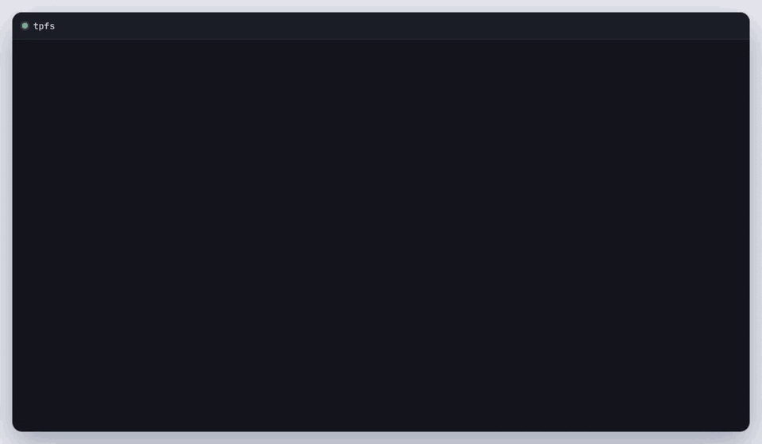

# tpfs

tpfs makes file operations safe and reversible. You describe a change as a **plan**: a JSON list of
moves, copies, renames, trashes and folder operations. tpfs validates the plan, shows a preview with
its risk and a SHA-256 digest, and runs it only after you approve exactly that plan. Every step goes
through a write-ahead journal, so you can undo the whole batch later, and a batch cut short by a
crash is rolled back on request. You can use it from the command line, from a two-panel file manager
in the terminal, or let an AI agent propose plans over MCP while you keep the final say.




## Guarantees

- **No overwrite.** A move, copy or rename never replaces an existing file. To replace a file, a
  plan trashes the old one first, so the old version stays restorable.
- **No permanent delete.** `trash` moves an item into tpfs's trash. There is no delete operation.
- **Undo.** Every committed batch can be reverted with `tpfs undo`, newest first.
- **Crash recovery.** Each step is journaled before it touches the disk. `tpfs recover` rolls back a
  batch that a crash or power loss interrupted.
- **Confinement to roots.** A plan may only touch paths inside the folders you allow with `--root`.
  Paths that go through a symlink are refused, and tpfs's own state can never be part of a plan.
- **Human approval for agents.** An agent can only propose. By default a plan from an agent runs only
  after a person runs `tpfs approve <id>` in their own terminal.

## Install

**Prebuilt binary.** Download the archive for your system from the
[latest release](https://github.com/kral/tpfs/releases/latest): Linux (x86_64, ARM64, static),
macOS (Apple silicon, Intel) or Windows (x64, ARM64). Unpack it and put `tpfs` (`tpfs.exe`) on your
`PATH`. `SHA256SUMS` lists the checksums.

```sh
# Linux x86_64 example
curl -LO https://github.com/kral/tpfs/releases/latest/download/tpfs-v0.7.2-x86_64-unknown-linux-musl.tar.gz
tar xzf tpfs-v0.7.2-x86_64-unknown-linux-musl.tar.gz
sudo install tpfs-v0.7.2-x86_64-unknown-linux-musl/tpfs /usr/local/bin/
```

**From source.** You need Rust 1.89 or newer.

```sh
git clone https://github.com/kral/tpfs
cd tpfs
cargo install --locked --path crates/tpfs
```

This puts one binary, `tpfs`, in `~/.cargo/bin`. See [Getting started](docs/getting-started.md) for
details.

## Quick start

Write a plan. Paths must be absolute.

```json
{
  "reason": "Tidy downloads",
  "ops": [
    { "op": "mkdir", "path": "/home/you/Downloads/Invoices" },
    { "op": "move", "from": "/home/you/Downloads/invoice-2026-03.pdf",
      "to": "/home/you/Downloads/Invoices/invoice-2026-03.pdf" }
  ]
}
```

Preview it, apply it, and undo it:

```sh
tpfs check plan.json --root ~/Downloads   # validate and preview; changes nothing
tpfs apply plan.json --root ~/Downloads   # preview again, ask "Apply? [y/N]", execute
tpfs undo                                 # revert the batch you just applied
```

Or open the commander in the current folder:

```sh
tpfs
```

## Documentation

- [The problem](docs/the-problem.md): how AI agents destroy files today, and what tpfs does about it
- [Getting started](docs/getting-started.md): build, first plan, preview, approve, execute, undo
- [Concepts](docs/concepts.md): plans, validation, risk, digest, journal, trash, roots, state folder
- [Command line](docs/cli.md): every command, flag and exit code
- [Commander (TUI)](docs/tui.md): keys and workflow of the two-panel file manager
- [Agent setup](docs/agent-setup.md): Claude Code and Cursor, the `tpfs guard` hook, `tpfs doctor`
- [MCP server](docs/mcp.md): let an AI agent propose plans that you approve
- [Plan format](docs/plan-format.md): the plan JSON
- [Recipes](docs/recipes.md): reusable commands an agent proposes and you run
- [Use cases](docs/use-cases/README.md): worked examples

## License

MIT or Apache-2.0, at your option.
