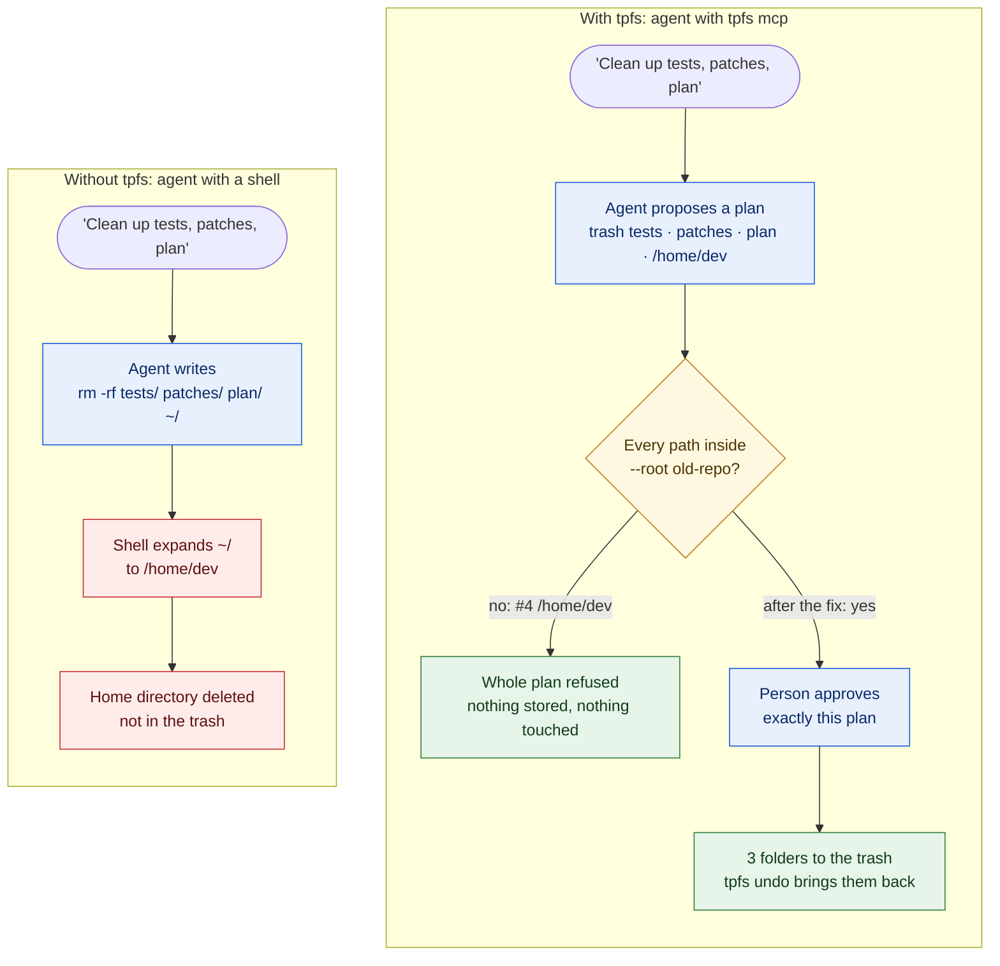
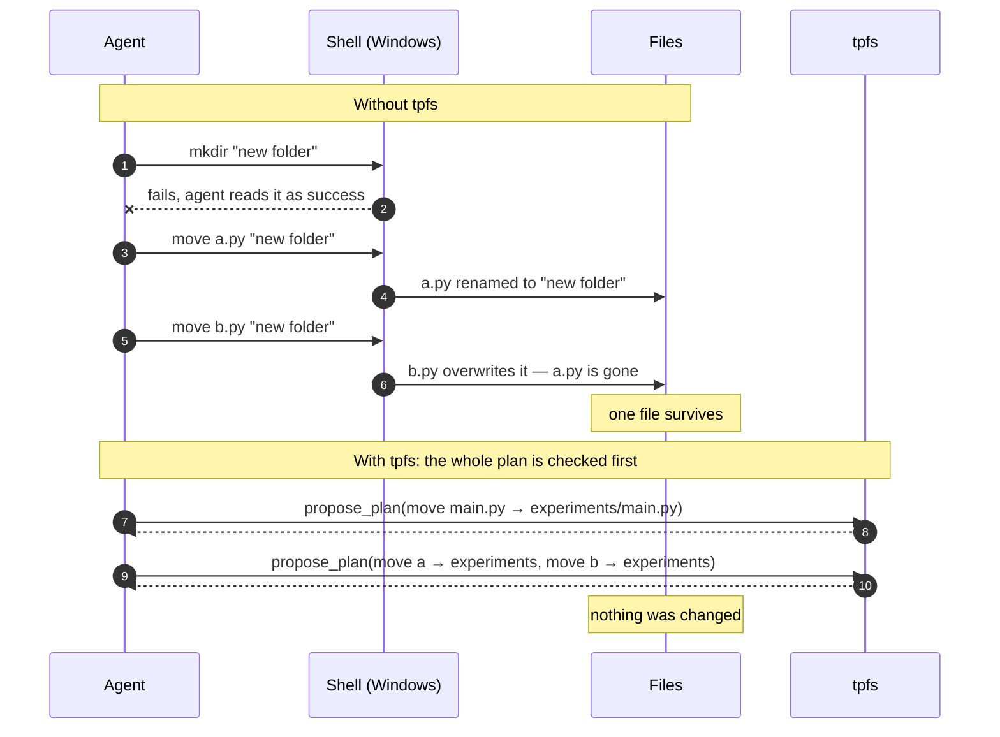
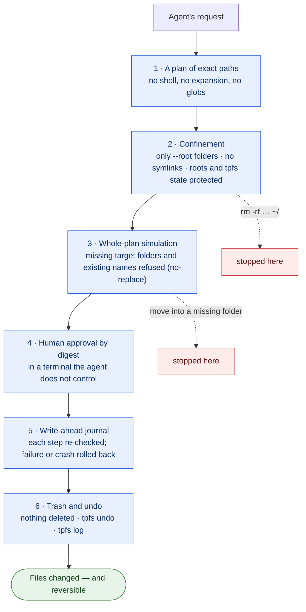

# Case study: the two best-known AI file disasters, replayed through tpfs

[The problem](../the-problem.md) collects what keeps going wrong when AI agents work with files.
This case study takes the two incidents that were discussed most and replays the same requests
through tpfs 0.5.0. Every output below is from an actual run; only the paths were shortened from a
scratch folder (`/tmp/…`) to `/home/dev`, so the ids and digests are those of that run.

## Incident 1: "clean up the old repo" deletes the home directory

**What happened** (r/ClaudeAI, December 2025): a developer asked Claude Code to clean up unused
tests, patches and plan documents in an old repository. The agent ran

```sh
rm -rf tests/ patches/ plan/ ~/
```

and the trailing `~/` expanded to the whole home directory. Nothing went to the trash.



**The same request through tpfs.** The agent gets `tpfs mcp --root /home/dev/old-repo` instead of a
shell for file work. It describes the cleanup as a plan, including the same mistake:

```json
{ "reason": "Clean up old repo: tests, patches, plan",
  "ops": [
    { "op": "trash", "path": "/home/dev/old-repo/tests" },
    { "op": "trash", "path": "/home/dev/old-repo/patches" },
    { "op": "trash", "path": "/home/dev/old-repo/plan" },
    { "op": "trash", "path": "/home/dev" }
  ] }
```

`propose_plan` refuses the whole plan before anything is stored or touched:

```json
{
  "issueCount": 1,
  "issues": ["#4: Outside the allowed folders: /home/dev"],
  "stepCount": 4,
  "valid": false
}
```

There is no shell expansion to go wrong: a plan names exact paths, and every path is checked
against the allowed folders. Even if the user had given the agent their whole home as a root, the
root itself cannot be removed:

```console
$ tpfs check wide.json --root /home/dev
  #1: Cannot trash an allowed root folder.
tpfs check: plan rejected (see the problems above); nothing was changed
```

**The corrected plan** (the three folders only) is accepted and waits for a person:

```json
{
  "planId": "18e98d5b169f1717c5",
  "preview": [
    "TRASH   /home/dev/old-repo/tests",
    "TRASH   /home/dev/old-repo/patches",
    "TRASH   /home/dev/old-repo/plan"
  ],
  "risk": "High",
  "riskReasons": ["proposed by an agent", "moves 3 whole folder(s) to the trash"],
  "valid": true
}
```

The developer approves it in their own terminal, bound to the plan's digest:

```console
$ tpfs approve 18e98d5b169f1717c5
…
Allowed folders: /home/dev/old-repo
Risk: HIGH — proposed by an agent; moves 3 whole folder(s) to the trash
Digest: 184b7ecdd20e1fd29f1a0d3d0dfbc4f1a664c594a55d306092dc97fe3fde4832
Type 'yes' to let the agent apply exactly this plan: yes
Approved. The agent can now call apply_plan for 18e98d5b169f1717c5.
```

The agent applies it (`"applied": 3`). `old-repo/` now holds only `src/`, and `~/Documents` was
never in reach. If the cleanup turns out to be wrong after all:

```console
$ tpfs undo
…
Undone batch 18e98d5d14efe370-d4 (3 step(s)):
  reverted: TRASH   /home/dev/old-repo/tests
  reverted: TRASH   /home/dev/old-repo/patches
  reverted: TRASH   /home/dev/old-repo/plan
```

## Incident 2: moves into a folder that does not exist overwrite every file

**What happened** (Gemini CLI, July 2025, AI Incident Database #1178): asked to move a project's
files into a new folder, the agent's `mkdir` failed silently and the agent did not notice. It then
moved each file to the non-existent folder name; on Windows that renames the file to that name, so
each file overwrote the previous one. One file survived.



**The same steps through tpfs.** A move into a folder that does not exist is refused at validation,
before anything runs:

```json
{
  "issues": ["#1: Target folder does not exist: /home/dev/old-repo/experiments"],
  "valid": false
}
```

And the overwrite chain itself cannot happen: when two moves aim at the same name, the second one
is refused, because no operation in tpfs ever replaces an existing entry:

```console
$ tpfs check gemini.json --root /home/dev/old-repo
  #2: Target already exists: /home/dev/old-repo/experiments
tpfs check: plan rejected (see the problems above); nothing was changed
```

Validation runs on the whole plan with each step's effect simulated, so a step that depends on an
earlier one (a `mkdir` the moves need) is checked in order. At run time each step is checked again
just before it runs; if a step fails, the batch stops and the steps before it are rolled back, so
"a failed command treated as a success" cannot carry on into the next step.

## Why the usual safeguards did not help, and what is different here

Each incident is stopped by one of the layers every plan goes through:




| In the incidents | With tpfs |
|---|---|
| Approval per shell command: the dangerous one slipped through, or auto-run skipped approval | The person approves the **whole plan**, with risk and totals, in a terminal the agent does not control (the default `--approval terminal`); the approval is bound to the digest. |
| Shell expansion (`~/`), quoting (`\`), globs decide the real target | No shell: exact paths, each one confined to the allowed folders, without symlinks on the way. |
| `rm -rf` / `rmdir /s /q` bypass the trash | `trash` is the only removal tpfs offers; every batch it ran is undoable with `tpfs undo`. |
| Moves overwrite silently | No-replace everywhere; missing target folders are refused. |
| Agent checkpoints do not cover shell changes | With tpfs as the agent's only file tool, every change is journaled. Give it no shell file commands (see Limits). |
| A crash mid-cleanup leaves a half-done state | The write-ahead journal lets `tpfs recover` roll an interrupted batch back. |

## How to set it up

Give the agent tpfs for file work and keep its shell out of it (or deny `rm`, `mv`, `del` and
friends in the agent's own permissions):

```json
{
  "mcpServers": {
    "tpfs": {
      "command": "/home/dev/.cargo/bin/tpfs",
      "args": ["mcp", "--root", "/home/dev/old-repo"]
    }
  }
}
```

Keep the roots narrow: the project the task is about, not the home directory. See
[MCP server](../mcp.md) for the options and [the DevOps case study](devops-release-cleanup.md) for a
longer flow with an incident and undo.

## Limits

tpfs protects the file operations that go through it: moves, copies, renames, new folders and
removal. It does not protect against an agent that also has a shell or an editing tool and uses it
for the same job, and it does not undo edits made inside a file's contents. The trash keeps
everything until you empty it yourself.
