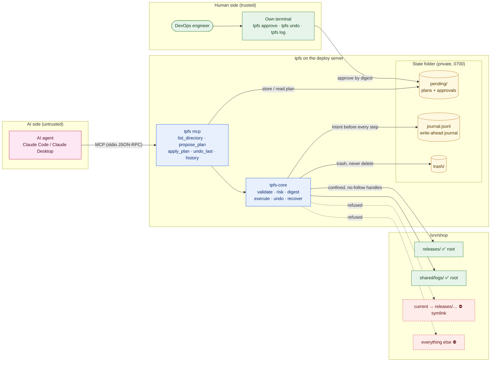
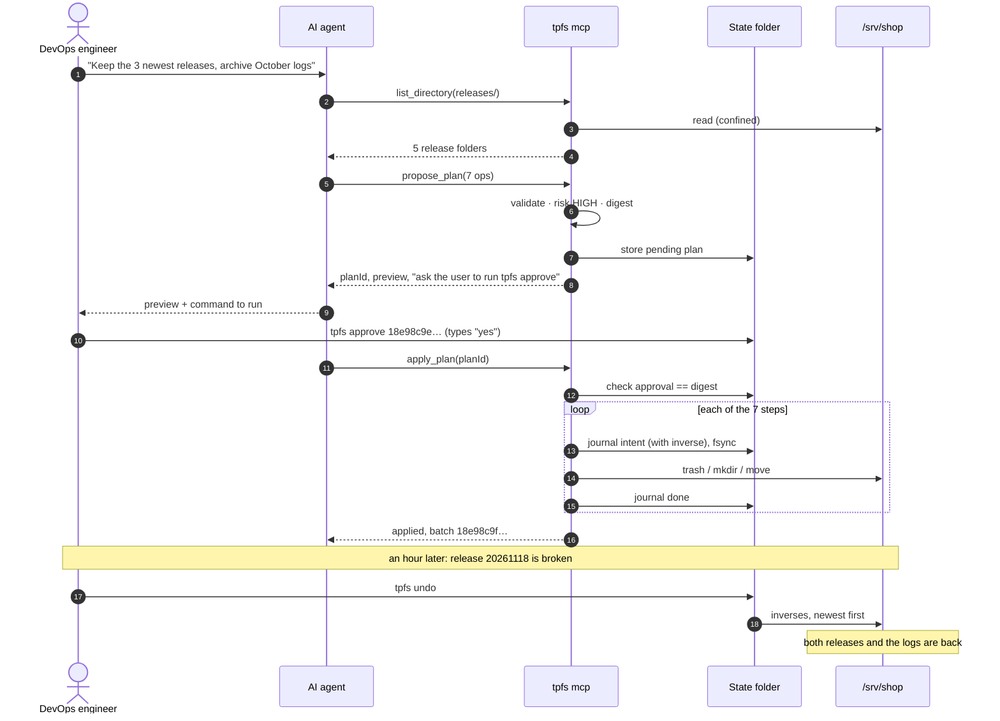
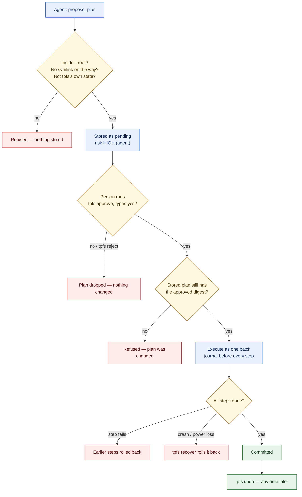

# Case study: an AI agent cleans up a deploy server

A real DevOps chore, done by an AI coding agent through `tpfs mcp`, with a person keeping the final
say and a one-command way back. Every output below comes from an actual run of tpfs 0.5.0; only the
paths were shortened from a scratch folder to `/srv/shop` (so the batch id and digest are those of
that run).

## The problem

A shop is deployed Capistrano-style: every deploy is a folder under `releases/`, `current` is a
symlink to the live one, and logs pile up in `shared/logs/`.

```text
/srv/shop
├── current -> releases/20261118-1045
├── releases/
│   ├── 20261102-0912
│   ├── 20261105-1544
│   ├── 20261110-0830
│   ├── 20261114-1720
│   └── 20261118-1045
└── shared/logs/
    ├── app-2026-10-01.log
    ├── app-2026-10-15.log
    ├── app-2026-10-31.log
    └── app-2026-11-18.log
```

The task for the agent: *keep the three newest releases and archive October's logs.*

Letting an agent do this with a shell is how incidents start: an `rm -rf` on the wrong release, a
glob that also matches the live one, no way back when the rollback target is gone. With tpfs the
agent can only **propose** a plan; a person approves exactly that plan; everything it did can be
undone.

## Architecture



The agent talks only to `tpfs mcp`. It can read and propose inside the two roots; a new change on
disk needs an approval written by a person in their own terminal (the agent may only undo its own
batches with `undo_last`), and every change goes through the journal first.

## Setup

Give the agent only the folders it needs. `current` and the rest of the server stay out of reach.

```json
{
  "mcpServers": {
    "tpfs": {
      "command": "/usr/local/bin/tpfs",
      "args": ["mcp", "--root", "/srv/shop/releases", "--root", "/srv/shop/shared/logs"]
    }
  }
}
```

This is the usual MCP client entry (Claude Desktop, Claude Code's `.mcp.json`, and others take the
same shape). The state folder is the deploy user's `~/.local/state/tpfs`; see
[MCP server](../mcp.md) for the options.

## The flow at a glance



## 1. The agent looks, then proposes

The agent lists `releases/` with `list_directory` and gets the five folders. It then calls
`propose_plan`:

```json
{
  "digest": "896ff1be2dd38e89049a7fa43a6644366ef361ce27d095e040ddd36ae2543242",
  "next": "Show the user the preview and ask them to run `tpfs approve 18e98c9e11e700f1d1 --home /home/deploy/.local/state/tpfs` in a terminal. Then call apply_plan.",
  "planId": "18e98c9e11e700f1d1",
  "preview": [
    "TRASH   /srv/shop/releases/20261102-0912",
    "TRASH   /srv/shop/releases/20261105-1544",
    "MKDIR   /srv/shop/shared/logs/archive",
    "MKDIR   /srv/shop/shared/logs/archive/2026-10",
    "MOVE    /srv/shop/shared/logs/app-2026-10-01.log  ->  /srv/shop/shared/logs/archive/2026-10/app-2026-10-01.log",
    "MOVE    /srv/shop/shared/logs/app-2026-10-15.log  ->  /srv/shop/shared/logs/archive/2026-10/app-2026-10-15.log",
    "MOVE    /srv/shop/shared/logs/app-2026-10-31.log  ->  /srv/shop/shared/logs/archive/2026-10/app-2026-10-31.log"
  ],
  "risk": "High",
  "riskReasons": ["proposed by an agent", "moves 2 whole folder(s) to the trash"],
  "stepCount": 7,
  "valid": true
}
```

Nothing has changed on disk yet. The plan waits in the state folder.

### What the agent cannot do

When the agent tried to reach the live release through the `current` symlink, the plan was refused
before it was even stored:

```json
{
  "issues": ["#1: Outside the allowed folders: /srv/shop/current/public"],
  "valid": false
}
```

Paths through symlinks, paths outside the roots and tpfs's own state are refused, however they are
spelled. There is no `delete`: `trash` is the only way to take something away, and it is undoable.

## 2. A person approves exactly this plan

The agent passes on the command from `next`. The person runs it in their own terminal, a channel
the agent does not control:

```console
$ tpfs pending
18e98c9e11e700f1d1  waiting  7 op(s)  Keep the 3 newest releases; archive October logs
$ tpfs approve 18e98c9e11e700f1d1
Plan 18e98c9e11e700f1d1 proposed by an agent:
  "Keep the 3 newest releases; archive October logs"
  TRASH   /srv/shop/releases/20261102-0912
  TRASH   /srv/shop/releases/20261105-1544
  MKDIR   /srv/shop/shared/logs/archive
  MKDIR   /srv/shop/shared/logs/archive/2026-10
  MOVE    /srv/shop/shared/logs/app-2026-10-01.log  ->  /srv/shop/shared/logs/archive/2026-10/app-2026-10-01.log
  MOVE    /srv/shop/shared/logs/app-2026-10-15.log  ->  /srv/shop/shared/logs/archive/2026-10/app-2026-10-15.log
  MOVE    /srv/shop/shared/logs/app-2026-10-31.log  ->  /srv/shop/shared/logs/archive/2026-10/app-2026-10-31.log
Total: 7 operation(s): 3 move (12 B), 2 trash (48 B), 2 mkdir
2 item(s) go to the trash (nothing is deleted; `tpfs undo` puts them back).
Allowed folders: /srv/shop/releases, /srv/shop/shared/logs
Risk: HIGH — proposed by an agent; moves 2 whole folder(s) to the trash
Digest: 896ff1be2dd38e89049a7fa43a6644366ef361ce27d095e040ddd36ae2543242
Type 'yes' to let the agent apply exactly this plan: yes
Approved. The agent can now call apply_plan for 18e98c9e11e700f1d1.
```

The approval is bound to the digest: if the stored plan were changed afterwards (by the agent or by
anyone with access to the file), `apply_plan` would refuse it. The person could also refuse with
`tpfs reject 18e98c9e11e700f1d1`.

## 3. The agent applies it

```json
{
  "applied": 7,
  "batch": "18e98c9fa578fdab-da",
  "undo": "undo_last reverts it; the user can also run `tpfs undo`."
}
```

The plan ran as one journaled batch: every step's inverse was on disk before the step touched
anything, so even a crash or power loss midway leaves a batch that `tpfs recover` rolls back.

```text
releases/          20261110-0830  20261114-1720  20261118-1045
shared/logs/       app-2026-11-18.log  archive/2026-10/{app-2026-10-01,15,31}.log
```

## 4. The incident: the rollback target is gone

An hour later the 20261118 release turns out to be broken, and the release to go back to is
20261105-1544, which the cleanup just moved to the trash. Instead of restoring from backup, the
person runs:

```console
$ tpfs undo
Undo batch 18e98c9fa578fdab-da by an AI agent — 7 step(s): Keep the 3 newest releases; archive October logs
These changes will be reversed:
  TRASH   /srv/shop/releases/20261102-0912
  TRASH   /srv/shop/releases/20261105-1544
  …
Undo it? [y/N] y
Undone batch 18e98c9fa578fdab-da (7 step(s)):
  reverted: TRASH   /srv/shop/releases/20261102-0912
  reverted: TRASH   /srv/shop/releases/20261105-1544
  …
$ cat /srv/shop/releases/20261105-1544/REVISION
build 20261105-1544
$ tpfs log
18e98c9fa578fdab-da  agent  undone     7 step(s)  Keep the 3 newest releases; archive October logs
```

Both releases are back, byte for byte, and the logs are where they were. The usual deploy rollback
(pointing `current` at 20261105-1544) can proceed. The batch stays in the log as `undone`, with who
proposed it and why.

## Why the agent cannot cause the incident on its own



## What this shows

| Concern | How tpfs handles it |
|---|---|
| The agent deletes the wrong thing | tpfs offers no delete: `trash` only, and every batch is undoable with one command (as long as tpfs is its only file tool). |
| The agent touches the live release or the rest of the server | Only the `--root` folders are reachable; symlinks such as `current` are refused. |
| The agent acts without a human | Every agent plan is HIGH risk and, with the default `--approval terminal`, needs `tpfs approve` in a terminal, bound to the plan's digest. (`--approval client` leaves approval to the MCP client.) |
| A plan is swapped after approval | The digest no longer matches; `apply_plan` refuses it. |
| A crash or reboot mid-cleanup | The write-ahead journal lets `tpfs recover` roll the batch back. |
| Audit | `tpfs log` keeps every batch: who proposed it, why, each step and its undo. |

## Limits worth knowing

- **The trash does not free disk space.** Trashed items stay on the same disk (in tpfs's trash), and
  tpfs never empties it. For a disk-full emergency, use tpfs to make the cleanup reviewable and
  undoable, then empty the trash yourself once you are sure.
- **Undo is per batch.** `tpfs undo` reverts the whole batch, logs included. Keep unrelated chores
  in separate plans if you may want to undo only one of them.
- **Files only.** tpfs does not restart services, switch symlinks it is not given, or touch
  databases; those stay with your deploy tooling.
